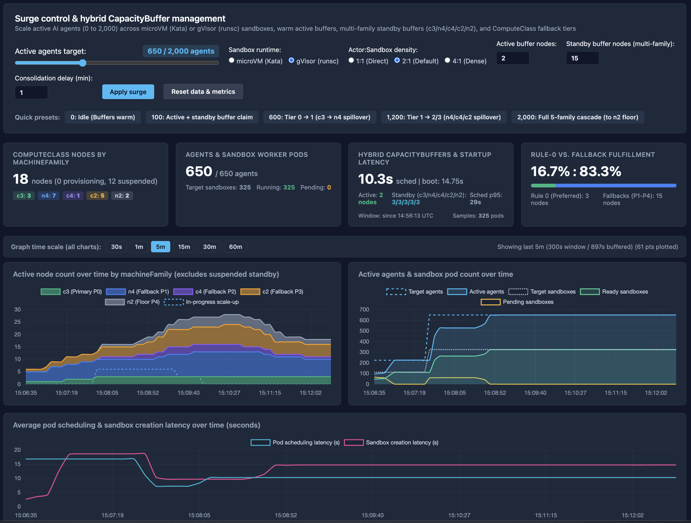
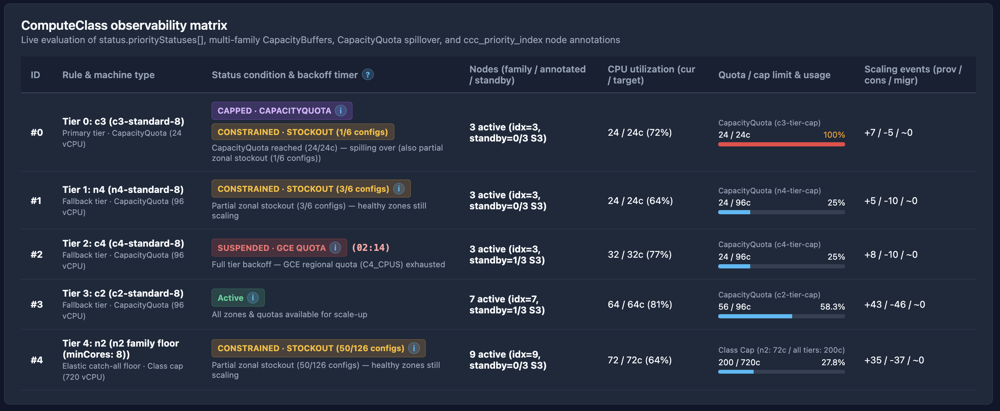
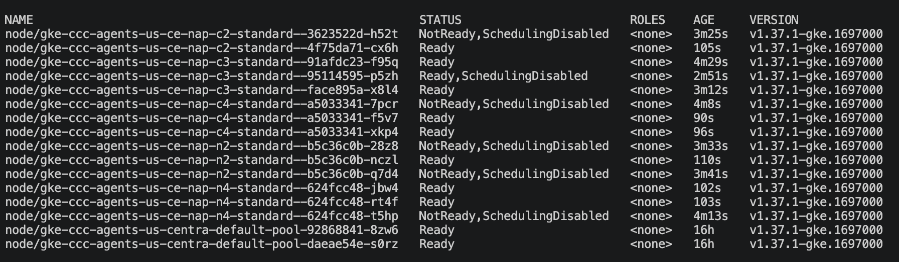

# GKE Agent Substrate - scale performance control tower

An interactive real-time observability and surge-scaling control tower for sandboxed AI agents on **Custom ComputeClasses (`cloud.google.com/v1`)**, **CapacityQuotas (`autoscaling.x-k8s.io/v1beta1`)**, and **Hybrid Active + Standby CapacityBuffers (`autoscaling.x-k8s.io/v1beta1`)**. It runs both sandbox runtimes, **microVM** and **gVisor**, in two modes:

| Mode | Nodes | Workers | What it shows |
|---|---|---|---|
| **Pause** (default) | GKE Sandbox nodes (`nodePoolConfig.sandbox.type: microvm \| gvisor`), the same nodes [Agent Sandbox](../../agent-sandbox) runs on | Pause pods with `runtimeClassName: microvm \| gvisor` | Capacity behavior on any cluster: a wide 5-tier ladder, quotas, buffers. Nothing is restored, so families mix freely. |
| **Substrate** | Agent Substrate nodes (no GKE Sandbox) | Real Agent Substrate (`ate.dev/v1alpha1`) WorkerPools and actors | The same capacity behavior under Substrate's snapshot rule: one lineage per machine family. |

The demo shows a bursty AI agent platform scaling from `0` to `2,000` sandboxed agents across a multi-family ComputeClass priority ladder. It claims pre-warmed active nodes and S3-suspended standby VMs, enforces per-family vCPU ceilings, and tells quota caps apart from zonal GCE stockouts.





---

## Architecture & capabilities demonstrated

1. **Dual sandbox runtimes (`microVM` and `gVisor`)**, each with its own ComputeClass:
   - **microVM** (`ComputeClass/agent-substrate-microvm`): hardware isolation on nested KVM, so the class sets `priorityDefaults.enableNestedVirtualization: true` and stays on Intel families. In pause mode it runs Kata Containers + Cloud Hypervisor through `runtimeClassName: microvm`.
   - **gVisor** (`ComputeClass/agent-substrate-gvisor`): an application kernel (runsc), no KVM needed, so any family works. In pause mode it runs through `runtimeClassName: gvisor`.
   - Pause mode uses the GKE Sandbox RuntimeClasses. Substrate mode ships its own runsc and Cloud Hypervisor in the worker image and uses no RuntimeClass.
   - The Control Tower provides a live radio selector to toggle between `microVM (Kata)` and `gVisor (runsc)`.
   - When switching runtimes, the backend reconciles the change: scales the inactive runtime's `Deployment` and `WorkerPool` to `0`, scales the newly active runtime to the target replica count, and updates `CapacityBuffer` `podTemplateRef` pointers so warm active and S3-suspended standby buffers cleanly hand off between runtime tiers without orphaned resources.
2. **5-tier ComputeClass priority ladder (pause mode, `manifests/01-compute-class.yaml`)**, the same for both runtimes:
   - **Priority 0 (`c3-standard-8`)**: Primary compute-optimized tier.
   - **Priority 1 (`n4-standard-8`)**: First general-purpose fallback tier.
   - **Priority 2 (`c4-standard-8`)**: Next-generation compute-optimized fallback tier.
   - **Priority 3 (`c2-standard-8`)**: Secondary compute-optimized fallback tier.
   - **Priority 4 (`machineFamily: n2`, `minCores: 8`, `minMemoryGb: 32`)**: Elastic catch-all floor for broad zonal availability.
   - **Fast consolidation**: Configured with `spec.autoscalingPolicy.consolidationDelayMinutes: 1` (adjustable live from the UI).
3. **Declarative per-tier & class-wide `CapacityQuota` (`manifests/02-capacity-quotas.yaml`)**:
   - Enforces pre-flight vCPU ceilings per machine family (`c3-tier-cap: 24`, `n4-tier-cap: 96`, `c4-tier-cap: 96`, `c2-tier-cap: 96`) and across the entire ComputeClass (`agent-substrate-class-cap: 720`).
   - When a priority tier reaches 100% of its `CapacityQuota`, Cluster Autoscaler skips proposing new nodes in that tier pre-flight and immediately spills over to the next priority rule without waiting for GCE failure backoffs.
4. **Hybrid Active + Multi-Family Standby `CapacityBuffer`s (`manifests/03-standby-buffer.yaml`)**:
   - **Active capacity buffer (`buffer.x-k8s.io/active-capacity`)**: Keeps pre-booted, running nodes ready for immediate pod scheduling (`<2s`).
   - **Standby capacity buffers (`buffer.gke.io/standby-capacity`)**: Pre-provisions GCE VMs across `c3`, `n4`, `c4`, `c2`, and `n2` and suspends them to ACPI S3 state (`Suspended=True` / taint `buffer.gke.io/standby-capacity-node-suspended:NoSchedule`), resuming them in ~15–20s during traffic surges without paying running compute costs while idle.
5. **Real-time telemetry & spillover disambiguation**:
   - Streams cluster state via Server-Sent Events (SSE) on port `8881`.
   - Separates active running nodes from suspended S3 standby nodes in the **ComputeClass node count** chart so pre-provisioned standby capacity never inflates active node counts.
   - Tracks both **Target agents** and **Active agents** (`readyMicrovms * actorsPerWorker`) alongside sandbox pod readiness and scheduling/boot latencies.
   - Disambiguates every priority tier's scaling state into explicit badges:
     - `Active`: All zones and quotas available for scale-up.
     - `CAPPED · CAPACITYQUOTA`: Pre-flight Kubernetes `CapacityQuota` reached (`100%`) — spilling over to next tier.
     - `CONSTRAINED · STOCKOUT (X/Y configs)`: Partial zonal GCE stockout (`ProvisioningConstrained`) — healthy zones in the tier continue scaling.
     - `SUSPENDED · STOCKOUT`: Full-tier GCE stockout (`ProvisioningSuspended` with `reason: OutOfResources`).
     - `SUSPENDED · GCE QUOTA`: Full-tier GCP regional quota exhaustion (`ProvisioningSuspended` with `reason: QuotaExceeded`).
     - `PROVISIONING`: GCE VMs actively booting (`NodeProvisioningInProgress`).

---

## Prerequisites & dependencies

### 1. Google Cloud & GKE cluster requirements

To run against a live GKE cluster, your cluster must meet the following requirements:

- **GKE version & release channel**: **GKE Standard 1.37.0-gke.4713000+** (the microVM class's nested virtualization needs it), for example on the **`Rapid` release channel** (`--release-channel=rapid`). If you don't have one yet, run the control tower in standalone `--mock` simulation mode.
- **Feature dependencies.** Versions and setup steps change, so treat the linked GKE pages as the source of truth:

  | Dependency | Used by | Minimum GKE | Docs |
  |---|---|---|---|
  | `CapacityBuffer`, active | `agent-active-buffer` | 1.35.2-gke.1842000 | [About capacity buffers](https://docs.cloud.google.com/kubernetes-engine/docs/concepts/capacity-buffer), [Configure capacity buffers](https://docs.cloud.google.com/kubernetes-engine/docs/how-to/configure-capacity-buffer) |
  | `CapacityBuffer`, standby (suspended nodes) | `agent-standby-buffer-*` | 1.36.0-gke.2253000, with node pool auto-creation | Same pages. Standby buffers don't support GPUs, local SSDs or nodes over 208 GB of memory. |
  | `CapacityQuota` | `*-tier-cap`, class-wide cap | 1.36.2-gke.2064000 | [Configure granular resource limits](https://docs.cloud.google.com/kubernetes-engine/docs/how-to/configure-capacity-quotas) |
  | GKE Sandbox, gVisor and microVM | Pause mode | 1.37.0-gke.4713000 for microVM | [Isolate workloads by using GKE Sandbox](https://docs.cloud.google.com/kubernetes-engine/docs/how-to/sandbox-pods#choose-sandbox-auto-created), [Use nested VMs with GKE clusters](https://docs.cloud.google.com/kubernetes-engine/docs/how-to/nested-virtualization) |
  | Agent Substrate | Substrate mode only | 1.37 | [Install Agent Substrate on GKE](https://docs.cloud.google.com/kubernetes-engine/ai-ml/install-overview-substrate). See [the example's prerequisites](../README.md#prerequisites). |
- **Node pool auto-creation**: Don't enable cluster-level node auto-provisioning (`--enable-autoprovisioning`). It isn't needed and isn't recommended, because it forces you to set cluster-wide CPU and memory limits. Each ComputeClass here turns on auto-creation for itself with `nodePoolAutoCreation.enabled: true`, scoped to just that class and with no cluster-level limits to size. Use quota (`CapacityQuota`) to cap the surge instead.
- **Autoscaling profile**: Leave the cluster default. Fast scale-down comes from `spec.autoscalingPolicy.consolidationDelayMinutes` in each ComputeClass, which is tuned per class and does the job of `--autoscaling-profile=optimize-utilization`.
- **Region & machine availability**: Choose a region offering the ladder's machine series (`c3`, `n4`, `c4`, `c2`, `n2`), such as `us-central1`. microVM needs Intel series that support nested virtualization; these all do.
- **Workload Identity & Dataplane V2**: Needed only for Substrate mode (`--workload-pool=<PROJECT_ID>.svc.id.goog --enable-dataplane-v2`). The [Substrate installer](https://docs.cloud.google.com/kubernetes-engine/ai-ml/install-overview-substrate) sets them up on clusters it creates.

#### Create a compatible GKE 1.37+ cluster from scratch

```bash
export PROJECT_ID="your-gcp-project-id"
export CLUSTER_NAME="agent-substrate-demo"
export REGION="us-central1"

gcloud container clusters create "${CLUSTER_NAME}" \
  --project="${PROJECT_ID}" \
  --region="${REGION}" \
  --release-channel=rapid \
  --cluster-version=1.37 \
  --machine-type=n2-standard-2 \
  --num-nodes=1 \
  --enable-dataplane-v2 \
  --workload-pool="${PROJECT_ID}.svc.id.goog"

gcloud container clusters get-credentials "${CLUSTER_NAME}" \
  --region="${REGION}" \
  --project="${PROJECT_ID}"
```

### 2. Local workstation dependencies

- **`gcloud` CLI**: Authenticated (`gcloud auth login` and `gcloud auth application-default login`).
- **`kubectl` (`v1.28+`)**: Configured with `cluster-admin` permissions on the target cluster (includes built-in `kubectl apply -k` Kustomize support).
- **`python3` (`3.10+`) with `venv`**: Required when running the FastAPI telemetry server locally via `./run-local.sh` (automatically creates `.venv` and installs dependencies from `app/requirements.txt`: `fastapi`, `uvicorn[standard]`, `kubernetes`, `pydantic`, `pytest`, `httpx`).
- **`jq`**: Required only if running the optional CLI diagnostic scripts in `scripts/`.

---

## Step-by-step setup & installation

Navigate to the `scale-demo` directory:

```bash
cd agent-substrate/scale-demo
```

### Step 1: Install the Kubernetes manifests on your cluster

Run the installation script to apply the `agent-substrate-demo` namespace, structural Agent Substrate CRDs (`WorkerPool`, `ActorTemplate`), the `agent-substrate-microvm` and `agent-substrate-gvisor` `ComputeClass`es, `CapacityQuota`s, `CapacityBuffer`s, and the dashboard deployment:

```bash
./install.sh
```

What `./install.sh` applies (via `kustomization.yaml`):
1. [`manifests/00-namespace-and-crds.yaml`](./manifests/00-namespace-and-crds.yaml): Creates the `agent-substrate-demo` namespace and registers structural `WorkerPool` and `ActorTemplate` CRDs (`ate.dev/v1alpha1`) if not already installed on the cluster.
2. [`manifests/01-compute-class.yaml`](./manifests/01-compute-class.yaml): Configures the 5-tier (`c3` &rarr; `n4` &rarr; `c4` &rarr; `c2` &rarr; `n2`) `agent-substrate-microvm` `ComputeClass` (`sandbox.type: microvm`, `enableNestedVirtualization: true`) and `agent-substrate-gvisor` `ComputeClass` (`sandbox.type: gvisor`), both with `consolidationDelayMinutes: 1`.
3. [`manifests/02-capacity-quotas.yaml`](./manifests/02-capacity-quotas.yaml): Creates `c3-tier-cap` (`24` vCPU), `n4-tier-cap` (`96` vCPU), `c4-tier-cap` (`96` vCPU), `c2-tier-cap` (`96` vCPU), and `agent-substrate-class-cap` (`720` vCPU).
4. [`manifests/03-standby-buffer.yaml`](./manifests/03-standby-buffer.yaml): Creates `PodTemplate`s for both runtimes and 6 `CapacityBuffer`s (`agent-active-buffer` + 5 per-family `agent-standby-buffer-*` resources) in `agent-substrate-demo`. Switching runtimes repoints the buffers at the other runtime's template.
5. [`manifests/04-agent-substrate-pool.yaml`](./manifests/04-agent-substrate-pool.yaml): Deploys the `WorkerPool`s, `ActorTemplate`, and the `agent-substrate-microvm-workers` and `agent-substrate-gvisor-workers` Deployments (initially scaled to `0` replicas) in `agent-substrate-demo`.
6. [`manifests/05-dashboard.yaml`](./manifests/05-dashboard.yaml): Deploys the in-cluster `ccc-agents-dashboard` Service and Deployment on port `8881` in `agent-substrate-demo`.

*(Optional)* To drive a real Agent Substrate install instead of pause pods, see [Substrate mode](#substrate-mode-optional-real-agent-substrate-one-snapshot-lineage-per-machine-family) below.

#### Waiting for standby `CapacityBuffer` nodes to provision and suspend

Standby `CapacityBuffer`s (`buffer.gke.io/standby-capacity`) take a few minutes after initial installation to provision new GCE VMs, complete node initialization (`buffer.gke.io/standby-capacity-init-time: "2m"`), and transition into a suspended ACPI S3 state.

Watching `kubectl get nodes` is a convenient way to verify that the standby nodes have first provisioned (`Ready`), been cordoned (`Ready,SchedulingDisabled`), and finally settled into the suspended state (**`NotReady,SchedulingDisabled`**):

```bash
watch kubectl get nodes
```



Once the standby nodes display `NotReady,SchedulingDisabled` (with condition `Suspended=True`), your multi-family standby pool is armed and ready for rapid S3 resume on surge.

---

### Substrate mode (optional): real Agent Substrate, one snapshot lineage per machine family

The default install (pause mode) uses pause-pod workers on GKE Sandbox nodes and stub `ate.dev` CRDs. It shows the ComputeClass, CapacityBuffer and CapacityQuota scaling behavior on any cluster, with nothing else installed. Pause pods have no memory snapshots, so in pause mode workers fall back across machine families freely, as stateless [Agent Sandbox](../../agent-sandbox) sessions can. Real Substrate workers cannot: a snapshot restores only on hardware compatible with the hardware that took it, which is why Substrate mode runs one pool per family. Treat pause mode as a demo of the capacity behavior, not of what Substrate allows. Substrate mode runs the same control tower against a **real Agent Substrate install**: real `WorkerPool`s, real `ActorTemplate`s with golden snapshots, and actors you can create, suspend and resume.

**Prerequisite:** Agent Substrate installed on the cluster with the [substrate-gke installer](https://github.com/ai-on-gke/substrate-gke) (the manifests pin `v0.4.0-gke.0`). Install its snapshot bucket and, for microVM, the `microvm` `SandboxConfig` (`hack/install-microvm-deps.sh`; on an Apple Silicon workstation pass `ARCH=amd64`). Build the `kubectl-ate` plugin from source (it is not part of the installer, and `go install ...@latest` fails because the module has `replace` directives): `git clone --branch v0.4.0 https://github.com/agent-substrate/substrate.git && cd substrate && go install ./cmd/kubectl-ate` (needs Go 1.27+), then put `$(go env GOPATH)/bin` on your `PATH` and check `kubectl ate --help`. Match the plugin to the cluster: the manifests pin `v0.4.0-gke.0`, whose upstream tag is `v0.4.0`. A newer plugin (for example the `@latest` v0.6.0) fails with `InvalidArgument … unknown field with protobuf tag`. `kubectl get deploy -n ate-system -o wide` shows the server version.

Then:

```bash
./install.sh --mode=substrate --bucket=<substrate-snapshot-bucket>
```

What it applies (from [`substrate/`](./substrate/)):

1. **Two ComputeClasses**: `agent-substrate-microvm` (`c4` &rarr; `n4` &rarr; `c3`, nested virtualization on) and `agent-substrate-gvisor` (`c4` &rarr; `c4d` &rarr; `n4` &rarr; `n4d` &rarr; `c3` &rarr; `c3d`), all `-standard-8`. The class stamps `ate.dev/substrate-version` on its nodes through `nodeLabels`, so Substrate's `atelet` DaemonSet lands on them without the workers selecting that label.
2. **CapacityQuotas**: one per machine family plus a class-wide cap.
3. **CapacityBuffers**: one active buffer, a standby buffer per family, and a small *seed* buffer per microVM family (see below).
4. **One WorkerPool per runtime and family** (`microvm-c4`, `microvm-n4`, …, `gvisor-c3d`), each pinned to its family with `node.kubernetes.io/instance-type`.
5. **One ActorTemplate per pool** in the `agent-substrate-demo` atespace, using the digest-pinned `counter` image. Each template builds its own golden snapshot on its own family.

**Why one pool per family.** A microVM FULL (memory) snapshot restores only on a compatible host: TSC frequency and CPUID differ between `c4`, `n4` and `c3`, so a snapshot can crash on restore on another family. One ComputeClass per runtime still provides the fallback ladder. Each family gets its own WorkerPool and ActorTemplate, so every snapshot lineage stays on the family it was taken on. A single unpinned pool would scatter workers across families and break restores. (Pinning each pool to one rule with `node.kubernetes.io/instance-type` gives up size fallback. That suits the demo, where the tower does the spilling between families. Outside the demo, see [the example's class-per-lineage pattern](../README.md#best-practices).)

**gVisor: build each golden on the least-capable host.** gVisor FULL snapshots ignore the TSC, but they only restore on a host with every CPU feature the golden snapshot saw, and hosts of one machine type differ: `tsc_deadline_timer` is exposed in some zones and not others. A golden built on a host with the flag crashes on hosts without it (`incompatible FeatureSet: missing features: map[tsc_deadline_timer:{}]`). A golden built on a host without the flag restores on both. To steer it, pin the pool to such a node with a temporary `kubernetes.io/hostname` nodeSelector, create the template, then remove the pin.

**How the tower spills between families.** In Substrate mode the tower reconciles every 10s:

- New demand goes to the first family in the ladder.
- If a family's workers stay unscheduled for `SPILL_AFTER_SECONDS` (default 120) — its `CapacityQuota` is full, or GCE is out of capacity — the tower blocks that family for `SPILL_COOLDOWN_SECONDS` (default 300). It keeps the workers already placed there and moves the rest to the next family's pool.
- The tower reads the cluster autoscaler's events to tell a slow family from a stuck one. A worker whose latest verdict is `TriggeredScaleUp` has a node on the way, so it does not start the spill timer until `SCALEUP_INFLIGHT_SECONDS` (default 600) pass without that node arriving. `NotTriggerScaleUp` (quota full, no matching node group) and `FailedScaleUp` (stockout) count from the moment the worker was created.
- The tower keeps its target in memory. When it restarts, it reads the target back from the `replicas` already on the WorkerPools, so it never scales a running demo to zero.
- Placed workers are never moved back.
- Scale-down removes unscheduled workers first, then the lowest families first.

**Seed buffers.** microVM workers request the `ate.dev/kvm` extended resource, which only exists on a node once `atelet` runs there. So the autoscaler cannot scale a microVM family up from zero nodes. When a microVM family first gets workers, the tower sets that family's `agent-seed-<family>` CapacityBuffer to 1. That buffer is a 250m pause pod that brings up the first node; after that, the autoscaler grows the family from the worker pods themselves. `c4d` and `c3d` expose no `svm` flag to nested guests, so they host gVisor only. `n4d` is left out of the microVM ladder.

Measure actor latency per family once workers are running:

```bash
./scripts/substrate-actor-load.sh --runtime=microvm --actors=3
```

`./uninstall.sh` detects a real install. It suspends and deletes the demo's actors, tags and templates, then removes the atespace, buffers, pools, quotas and classes. **It leaves the `ate.dev` CRDs and the rest of Agent Substrate in place.**

### Step 2: Launch & access the control tower UI (Port `8881`)

You can run the control tower in three ways:

#### Option A: Run locally against your active `kubectl` context (Recommended)

Running the FastAPI server locally uses your local `kubeconfig` credentials and provides sub-20ms UI response times:

```bash
./run-local.sh
# To start directly with gVisor sandbox runtime:
# ./run-local.sh --runtime gvisor
```

Then open **`http://localhost:8881`** in your browser.
*(To override the bind address or port: `HOST=0.0.0.0 PORT=8881 ./run-local.sh`)*

#### Option B: Port-forward to the in-cluster dashboard Service

If you prefer not to run Python locally, forward port `8881` to the `ccc-agents-dashboard` Service deployed by `./install.sh`:

```bash
kubectl port-forward svc/ccc-agents-dashboard 8881:8881 -n agent-substrate-demo
```

Then open **`http://localhost:8881`** in your browser.

#### Option C: Standalone mock simulation mode (No GKE cluster required)

To explore the UI, priority spillover mechanics, and quota controls offline without a Kubernetes cluster:

```bash
./run-local.sh --mock
# Or simulate gVisor runtime offline:
# ./run-local.sh --mock --runtime gvisor
```

Then open **`http://localhost:8881`** in your browser.

---

### Accessing the UI from a local laptop when running on a remote VM / bastion host

If you are running `./run-local.sh` or `kubectl port-forward` on a remote Linux workstation, Cloud VM, or bastion host and want to view the browser UI on your local laptop, forward local port `8881` over SSH from your laptop terminal:

```bash
# Standard SSH local port forwarding from your laptop:
ssh -N -L 8881:127.0.0.1:8881 <your-username>@<remote-host>

# Or if connecting to a Google Cloud Compute Engine VM via gcloud:
gcloud compute ssh <vm-name> --zone=<zone> -- -NL 8881:127.0.0.1:8881
```

Keep the SSH terminal open and navigate to **`http://localhost:8881`** in your laptop browser.

---

## Using the control tower

### 1. Surge controls, KPI cards & time-series telemetry charts


- **Sandbox runtime (`microVM (Kata)` / `gVisor (runsc)`)**: Live radio selector switching the active agent workload and capacity buffer pod templates between Kata microVMs (`runtimeClassName: microvm`) and gVisor application kernels (`runtimeClassName: gvisor`).
- **Active agents target (`0` – `2,000`)**: Drag the slider or click one of the **Quick presets**, then click **Apply surge** (presets apply automatically):
  - **`0: Idle (Buffers warm)`**: Scales active sandbox worker pods to `0` while keeping active and standby `CapacityBuffer`s warm.
  - **`100: Active + standby buffer claim`**: Launches `50` sandbox worker pods (at `2:1` density), immediately claiming warm active buffer nodes and triggering S3 standby VM resume.
  - **`600: Tier 0 → 1 (c3 → n4 spillover)`**: Launches `300` sandbox worker pods (`~12` nodes). Tier 0 (`c3`) hits its `24` vCPU (`3` node) `CapacityQuota` (`CAPPED · CAPACITYQUOTA`) and spills over into Tier 1 (`n4`).
  - **`1,200: Tier 1 → 2/3 (n4/c4/c2 spillover)`**: Launches `600` sandbox worker pods (`~24` nodes), cascading across `c3`, `n4`, and `c4`/`c2`.
  - **`2,000: Full 5-family cascade (to n2 floor)`**: Launches `1,000` sandbox worker pods (`~40` nodes), saturating `c3`, `n4`, `c4`, and `c2` quotas and spilling into the elastic `n2` catch-all floor.
- **Actor:Sandbox density (`1:1`, `2:1`, `4:1`)**: Controls how many logical AI agents pack into each sandbox worker pod (`targetSandboxes = ceil(targetAgents / actorsPerWorker)`).
- **Active buffer nodes (`0` – `50`)**: Adjusts `spec.replicas` on `CapacityBuffer/agent-active-buffer`.
- **Standby buffer nodes (`0` – `100`)**: Distributes standby replicas across all priority families (`agent-standby-buffer-<family>`).
- **Consolidation delay (`1` – `1440` min)**: Live-patches `ComputeClass.spec.autoscalingPolicy.consolidationDelayMinutes`.
- **Reset data & metrics**: Clears the rolling chart history, resets pod scheduling/boot latency averages & P95 window to the current timestamp, and re-baselines per-tier `Provisioned / Consolidated / Migrated` counters to `0`.
- **Graph time scale (`30s`, `1m`, `5m`, `15m`, `30m`, `60m`)**: Zooms all three charts across up to 60 minutes of buffered telemetry (automatically downsampled on `5m+` windows to prevent visual congestion):
  1. **Active node count over time by machineFamily**: Stacked area chart of **active running nodes** per family (excluding suspended S3 standby nodes so idle standby capacity never looks like over-provisioning).
  2. **Active agents & sandbox pod count over time**: Plots `Target agents` (dashed sky-blue), `Active agents` (solid sky-blue), `Target sandboxes` (dashed white), `Ready sandboxes` (green), and `Pending sandboxes` (amber).
  3. **Average pod scheduling & sandbox creation latency over time**: Tracks average pod scheduling latency (`PodScheduled`) and sandbox creation latency (`ContainersReady - PodScheduled`).

### Guided tour (optional)

New to the demo? A floating **Guided tour** panel (bottom-right) walks through what to do first. It shows a different step list in pause mode and Substrate mode, based on the mode the server reports, and marks steps done from live telemetry (Capacity ready, target set, sandboxes placed, fallback or spill seen) or with **Mark done**. Collapse it, close it with **X**, and reopen it with the **Guide** button in the header; it opens on your first visit and remembers your choice in `localStorage`. The tour is data-driven: edit `STEPS` in [`app/static/guide.js`](./app/static/guide.js).

The header **Capacity** badge reads *warming up* until every `CapacityBuffer` is `ReadyForProvisioning` and the suspended standby nodes cover the standby replicas, then *ready to scale* (always ready in `--mock`). Wait for it before your first surge. It goes back to *warming up* for about 3–4 minutes after a burst or scale-down, while replacement standby nodes boot, wait out the buffer's 2-minute init time and suspend; wait for green again before the next measured run.

### 2. ComputeClass observability matrix & status disambiguation


- **Status condition & backoff timer**: Click or hover the `?` header icon or any row's `i` badge to inspect the live GKE `status.priorityStatuses[]` condition, excluded zonal configuration ratio (e.g., `(3/6 configs)`), and active backoff countdown timer.
- **Nodes (family / annotated / standby)**: Displays active running nodes in that family alongside the `ccc_priority_index` annotation count and suspended S3 standby buffer count (`standby=X/Y S3`).
- **Quota / cap limit & usage**: Unified progress bars showing real-time vCPU consumption against each tier's `CapacityQuota` (`c3-tier-cap`, `n4-tier-cap`, `c4-tier-cap`, `c2-tier-cap`) or the class-wide `agent-substrate-class-cap`.
- **Live `CapacityQuota` API adjustments**: Dynamically raise or lower any tier's `CapacityQuota` vCPU ceiling at runtime via `POST /api/quotas`:
  ```bash
  curl -X POST http://localhost:8881/api/quotas \
    -H "Content-Type: application/json" \
    -d '{"quotaName": "n4-tier-cap", "cpuLimit": 128}'
  ```

---

## Running unit & integration tests

```bash
python3 -m venv .venv
.venv/bin/pip install -q -r app/requirements.txt
.venv/bin/pytest -q
```

---

## Stopping the demo & cleanup

### Spin down all ComputeClass nodes while keeping the cluster
To scale all workloads and active/standby buffers to `0` so Cluster Autoscaler consolidates all demo nodes (pause mode):

```bash
kubectl scale deployment/agent-substrate-microvm-workers deployment/agent-substrate-gvisor-workers --replicas=0 -n agent-substrate-demo
for buf in $(kubectl get capacitybuffers -n agent-substrate-demo -o name); do
  kubectl patch "${buf}" -n agent-substrate-demo --type=merge -p '{"spec":{"replicas":0}}'
done
```

### Full uninstall from the cluster
To remove all demo workloads, `CapacityBuffer`s, `CapacityQuota`s, both `ComputeClass`es, and the `agent-substrate-demo` namespace:

```bash
./uninstall.sh
```
